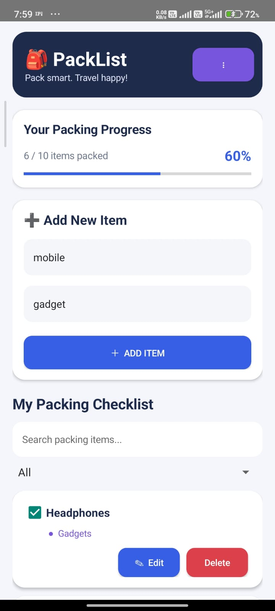
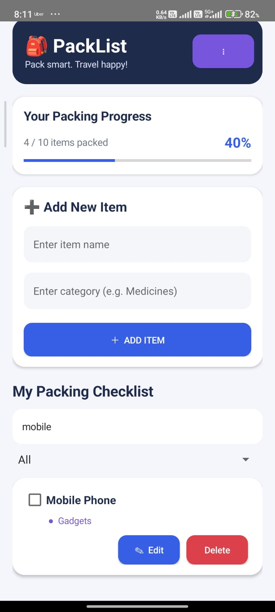
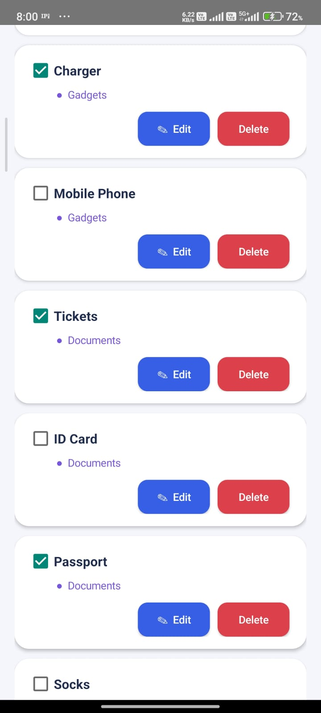
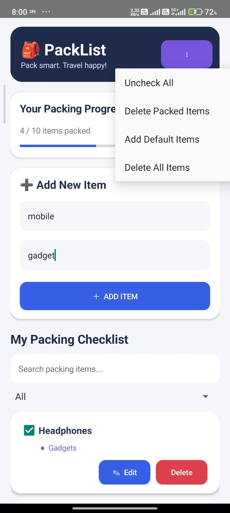

# 🎒 PackList – Packing Checklist App

An Android application developed using **Java and SQLite** that helps travellers organize their packing items, manage categories, and track their packing progress.

## 📱 Project Screenshots

### 1. Home Screen


### 2. Add Packing Item


### 3. Packing Checklist


### 4. Menu Options


---

## ✨ Features

- Add new packing items.
- Create custom categories.
- Edit existing packing items.
- Delete individual items.
- Mark items as packed or unpacked.
- Track packing progress.
- Search packing items.
- Filter items by category.
- Delete all packed items.
- Uncheck all items.
- Store data locally using SQLite.
- Works without an internet connection.

## 🛠️ Technologies Used

| Technology | Purpose |
|---|---|
| Java | Application development |
| Android Studio | Development environment |
| XML | User interface design |
| SQLite | Local database |
| Android SDK | Android application development |

## 🗄️ Database Design

The application uses SQLite to store packing information.

**Table Name:** `items`

| Column | Data Type | Description |
|---|---|---|
| id | INTEGER | Primary key |
| name | TEXT | Packing item name |
| category | TEXT | Item category |
| packed | INTEGER | Packing status (0 or 1) |

## 📂 Project Structure

```text
PackList/
│
├── app/
│   └── src/
│       └── main/
│           ├── java/
│           │   └── com/example/packlist/
│           │       ├── MainActivity.java
│           │       └── DatabaseHelper.java
│           │
│           ├── res/
│           │   └── layout/
│           │
│           └── AndroidManifest.xml
│
├── screenshots/
│   ├── home.png
│   ├── add-item.png
│   ├── checklist.png
│   ├── edit-delete.png
│   └── menu.png
│
└── README.md
```

## ⚙️ Installation and Setup

1. Download or clone this repository.
2. Open Android Studio.
3. Select **Open Project**.
4. Choose the PackList project folder.
5. Wait for Gradle synchronization.
6. Connect an Android device or start an emulator.
7. Click the Run button to install and launch the application.

## 🎯 Project Objective

The main objective of PackList is to provide a simple and user-friendly solution for travellers to prepare and manage their packing checklist. It helps users avoid forgetting essential items and makes travel preparation more organized.

## 👨‍💻 Developer

**Hardik Patel**

Project: PackList – Packing Checklist  
Domain: Mobile Application Development  
Platform: Android

---

⭐ If you find this project useful, consider giving the repository a star!
